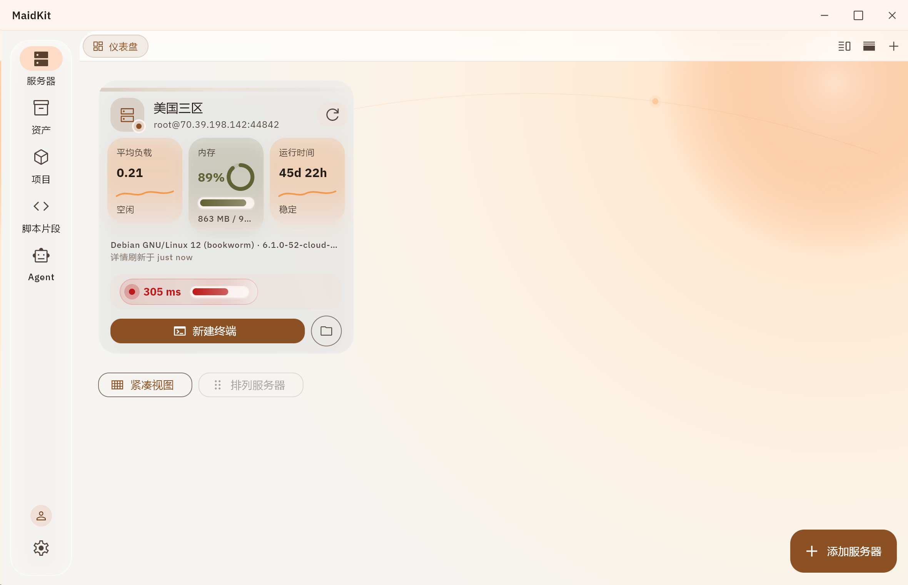
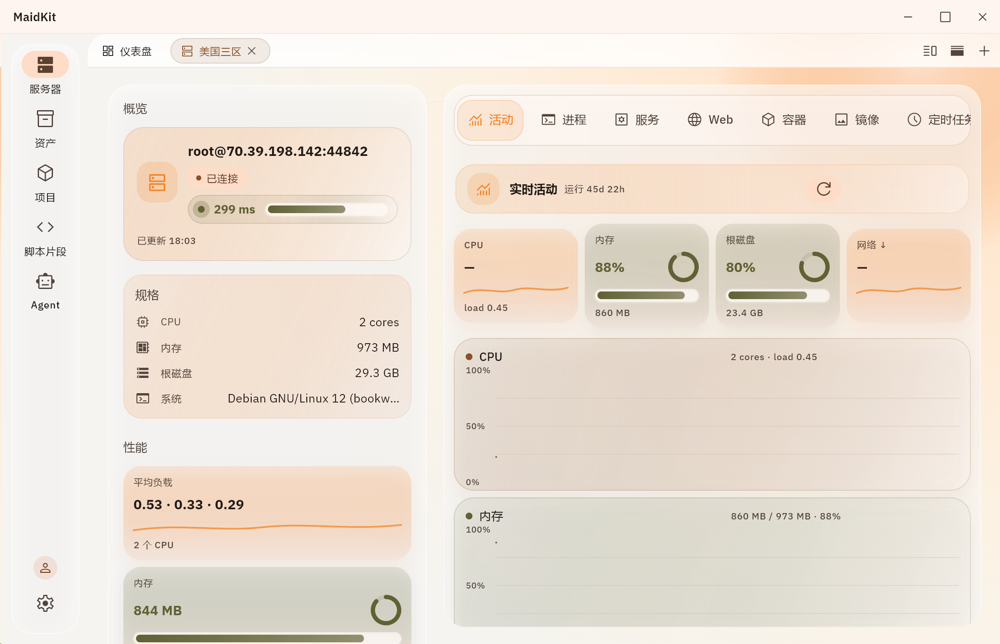
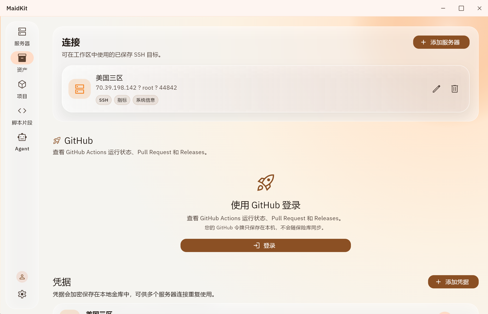
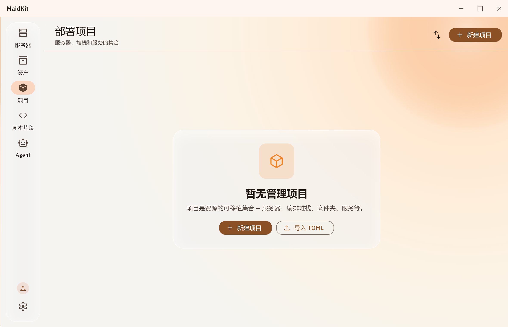

# Daybreak UI Language

Daybreak 是一套面向开发者工具、SSH 客户端、服务器管理器、本地工具软件的浅色优先 UI 设计语言。

它来自对 [Orange Cloud](https://github.com/YM040923/orange-cloud) 的视觉研究，以及 MaidKit Daybreak 美化过程中的实践总结。它**不是**任何一个项目的源码副本，也不复制它们的页面路由、业务结构或数据模型。

## 它解决什么问题

这套仓库同时服务两类人：

1. **给 Codex 使用**：把审美判断写成可执行、可检查、可拒绝的规则。
2. **给开发者学习**：通过 Token、组件状态、响应式规则和可运行 Demo 理解这套语言。

## 一句话理解

> 温暖但克制的工作空间 + 开发者工具的信息密度 + 状态驱动的小组件 + 苹果式的间距与反馈 + 不破坏原有工作流。

## 它不是什么

- 不是把所有东西染成橙色。
- 不是把所有东西做成玻璃卡片。
- 不是只改颜色和圆角的主题皮肤。
- 不是把手机页面放大到 Windows。
- 不是复制 Orange Cloud 的页面和业务结构。

## MaidKit 实际 Windows 界面参考

下面的图片来自这套设计语言实际应用到 MaidKit 后的 Windows 界面，不是仓库里另外编写的 Demo：

| 仪表盘 | 活动监控 |
| --- | --- |
|  |  |

| 资产与 GitHub | 项目空状态 |
| --- | --- |
|  |  |

这些图片用于帮助人和 Codex 理解真实的视觉结果；零依赖 Demo 仍然用于验证组件状态和响应式行为。图片来源和页面说明见 [screenshots/README.md](screenshots/README.md)。

## 运行 Demo

Demo 零依赖，不需要安装前端框架：

```powershell
python -m http.server 8080 -d demo
```

打开 `http://localhost:8080`。

也可以直接双击 `demo/index.html`。Demo 包含：

- 服务器、资产、项目、脚本片段、Agent、设置等页面示例；
- Windows 工作台和 Android 单列布局；
- 在线、连接中、离线、错误等连接状态；
- 正常、关注、降级、超时等延迟阶段；
- 状态切换时组件结构、文案和操作的同步变化。

## 推荐阅读顺序

### 人类

1. [DESIGN-LANGUAGE.md](DESIGN-LANGUAGE.md)
2. [COMPONENTS.md](COMPONENTS.md)
3. [STATES.md](STATES.md)
4. [RESPONSIVE.md](RESPONSIVE.md)
5. [COMPOSITION.md](COMPOSITION.md)

### Codex

1. [AGENTS.md](AGENTS.md)
2. [CODEX.md](CODEX.md)
3. [tokens/daybreak.json](tokens/daybreak.json)
4. `examples/` 下对应页面
5. Demo 中对应真实状态

## 未来如何扩展

以后可以继续建立其他 UI 语言项目，并保持相同的文件结构。组合多个项目时，不要把颜色、圆角和渐变机械叠加，而要按维度选择：

- A 提供信息架构；
- B 提供导航；
- Daybreak 提供环境层和状态组件；
- C 提供动效节奏；
- 最终统一到一个主视觉语言和一套 Token。

## 许可证

- Demo 代码和 Token：Apache-2.0，见 [LICENSE](LICENSE)。
- 文档和原创设计材料：CC BY 4.0，见 [LICENSE-DOCS](LICENSE-DOCS)。
- 第三方项目名称、商标和原始资源归其各自所有者。

